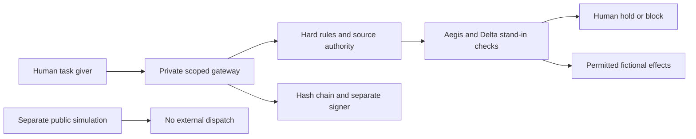

# Twinguard

> Qwen assisted with implementation, tests and documentation. This is not a claim of sole authorship of dependencies, references or external review inputs.

**Twinguard: two AI guards, Aegis and Delta, that check what your AI helpers do.**

## Quickstart And Current Gate

After installing Python3.12 dependencies, run `.venv/bin/python scripts/local_setup.py start` from this repository. No API key is needed; inherited AEGIS settings are discarded. Installation and startup have no promised60-second timing. Full setup and demo-account instructions follow below.

Current local verification: completed through round11, with rounds10 and11 establishing zero new findings. Rounds4-11 each passed2089 tests across30 shards. ON-004/006 admission faults and ON-005 signer wording repaired. See [final report](docs/final-audit/overnight-final-report.md). This is bounded local acceptance, not live managed-host release approval.



## FAQ

**Does it need a real key?** The local stand-in demo does not. Live-model results require separate measurement; a key alone is not proof.

**Is the public demo the private gateway?** No. The public entrypoint is an isolated simulation with no real worker, email, payment or model execution.

**Can the task giver approve their own action?** No. Private privileged operations require changed credentials and the applicable independent approval boundary.

**Can I reset failed audit history?** No. Preserve the entire original runtime. Demo reset allocates a synthetic child; it does not erase production evidence.

**Is this release-approved?** The bounded local review stopping rule passed through round11. Live managed-host operation still requires separate acceptance; nothing was deployed.

The isolated sandbox worker routes supported email, file and refund requests through Twinguard. This is not universal interception of arbitrary agents or tools outside this gateway. For these requests Twinguard gives one of four answers, explains why, and writes the decision into a tamper-evident log:

| Answer | Meaning |
|---|---|
| ✅ Allow | Safe. Twinguard carries out the action. |
| ✂️ Allow, redacted | Safe once sensitive values are removed. Twinguard removes them and shows what changed. |
| ✋ Hold | Too risky to decide alone. A human approves or denies. |
| ⛔ Block | Not allowed. The agent is told why. |

Built for Hackathon Track 2: AI Governance, Security & Decision-Making. Everything runs in a sandbox with made-up data and reserved `.example` domains — no real email, payments or client data.

## Fresh local start

Start in the repository root (the folder containing this README). Python 3.12 and locally available dependencies are required; port 8080 must be free. Installing from a public package index requires separate network permission; an offline machine needs an approved local wheel source. No API key is needed for this stand-in demo.

```bash
python3.12 -m venv .venv
.venv/bin/pip install -r requirements.txt
.venv/bin/python scripts/local_setup.py start
```

After installing dependencies, `start` is the single launch command. It exclusively copies `.env.example` to owner-only ignored `.env` if absent, preserves existing files, initializes private state, and starts without an API key. The copied template is an inventory, NOT loaded into the offline process: inherited AEGIS settings and live keys are discarded. Use `start --port 8081` for a free alternate port.

Open http://127.0.0.1:8080. If another task owns port 8080, do not stop it: use `.venv/bin/python scripts/local_setup.py run --port 8081` with a free port and open http://127.0.0.1:8081 instead. The setup step creates private `.local-runtime/` state: an evidence encryption key, an outside-data signer key/state, and an outside-data anchor. It never prints keys or overwrites an existing runtime. The launch helper removes inherited `AEGIS_*` settings, binds localhost, and disables live model calls. Direct `run.py` still refuses missing evidence keys; no security check is disabled.

In another terminal at the repository root, run only these quick checks and one disposable sponsor safety story:

```bash
.venv/bin/python -m pytest tests/test_local_setup.py -q
.venv/bin/python tests/test_sponsor_story_cli.py
.venv/bin/python scripts/sponsor_story.py
```

The story uses simulated Lumen S1 data, stand-in judges and the real gateway with a separate signer over local pipes. It prints actual decisions and audit checks; success means the R15 upload block and no effects, not complete sponsor acceptance. It does not reuse the running app's state. It may also block the preliminary read and reports that honestly.

Back up the **entire** private runtime while the app is stopped: data/SQLite and sidecars, checkpoint files, signer key and forward-only record, external anchor, evidence key/config, and any retained historical encryption keys after rotation. Keep backups private and outside Git. A fresh demo uses a new empty clone and new runtime; never move only the data folder or reset keys/anchors to hide failed verification. See [state and recovery](docs/deployment.md).

Sign in with a demo account, then **change its password on the Password page** — published demo passwords are refused for privileged actions (admin settings, approvals, policy edits) until replaced:

| User | Password | Role |
|---|---|---|
| dana | demo-dana-2026 | admin — account manager, gives tasks |
| ops | demo-ops-2026 | approver — operations lead, approves holds |
| audi | demo-audi-2026 | auditor — read-only |

**The person who set a task cannot approve it** — that is the two-person demo.

## Immediate local scripted demo

1. Use the local setup above, sign in as **dana**, and change the published password on the Password page.
2. Open `/admin/tools/review`. Inspect the displayed tool names, descriptions, input schemas, fingerprints and snapshot digest. Reauthenticate with the changed password, explicitly confirm the exact displayed sandbox snapshot, then select **Approve reviewed snapshot**. Do not import approval manifests from tests. If the snapshot changes, reload and review again.
3. Open `/admin/demo`, select **Reset demo**, then **Run five stories**. Each action allocates a fresh synthetic child; neither resets production history.
4. Open the saved **Proof** links, then **Source**, **Guard**, **Briefing** and **Results**. Match decisions and run/session bindings to this session's saved result. Source is emitted JSON evidence only, not a full source comparison.
5. Report the displayed outcomes, including HOLD and missing proof. Known sponsor outcomes are not a full sponsor score. Do not approve a held action to finish this demonstration.

See [operator runbook](docs/demo-runbook.md) and [run sheet](docs/run-sheet.md). Live execution, full suites, submission and recording acceptance are deferred; no live startup recipe is authorized by this local workflow.

## Architecture

```
Human (logged in) ──task──▶ Twinguard ──one-session token──▶ Worker "Mia" (own process)
                             │  Gate ▶ Task limits ▶ Session rules ▶ Data Firewall
                             │  ▶ Intent ▶ Risk Gate ▶ Executor + Injection Shield ▶ Audit
                             ▼
                   Sandbox company world (fresh copy per run)
                   Audit anchors (signed checkpoints outside the DB)
```

- **Rules first, AI second.** Hard rules give the guarantees; AI judges add coverage for meaning and run only when rules have not decided. No protection depends on an AI judge alone.
- **Fail closed.** Error, timeout or unreadable judge output never means Allow.
- **Least privilege.** The worker holds only the gateway address and a one-session token — no Qwen key, no database, no world, no policy file. Its model calls also go through Twinguard. A test proves the separation.
- **Tamper-evident audit.** Append-only at the database level (triggers refuse UPDATE/DELETE), hash-chained records, and a checkpoint with **every record**. Checkpoints are signed by a **separate signer process** (`aegis/signer.py`): the main app speaks a JSON-line protocol and never reads the signing key; the signer keeps its own **forward-only** record outside the data folder. A latest-checkpoint **external anchor** is also kept outside the data folder (`AEGIS_ANCHOR_EXTERNAL`). **What this achieves on a single-user machine (stated plainly):** process separation (the app has no code path to the key), owner-only permissions (state dir `0700`, key/record `0600`), and records a data-folder rollback cannot reach. It does **not** achieve OS-level read prevention against the same user — that needs a separate user account or container, which is a stated limit. **Verify detects:** edited/inserted records; deleted newest records; deleted/emptied checkpoint file with truncated log; removed last/middle checkpoint lines; reordered checkpoints; a coordinated rollback of records + checkpoint lines together (signer record and external anchor); a deleted or reset signer record; truncation below the signer's record; tampered checkpoint signatures (checked by the signer itself). **Verify does not detect:** an attacker who controls the database, the legacy key, the checkpoint file, the external anchor **and the signer's state directory** together; a rollback that predates the signer/anchor; legacy checkpoints from before the per-record regime are signature/position-checked but not per-record complete. **Signer down:** side-effect actions are **held** (HARD-SIGNER) and approved actions refuse to execute — never carried on unsigned; read-only actions continue and are chain-logged, and Verify reports the signer unreachable. Disabling the external anchor (`AEGIS_ANCHOR_EXTERNAL=""`) is reported by Verify as a gap.
- **Modes are per run.** `enforce` (normal), `monitor` (admin-only; decides and logs, lets through), `off` (only inside a labelled UNPROTECTED BASELINE run with its own world copy). There is no global off switch.

## Measured results

Historical scripted results below are not current acceptance. Section 6's prior normal-work measurement is **13/16 complete**, three false holds; its regression handoff remains **6 failed, 4 passed**. The 19 November closeout ran only demo repeatability and evidence-table checks: **9 passed**. See [current claim boundaries](docs/section-6-claims.md).

**Historical Scripted** (stand-in judge, full suites, real pipeline; not rerun in section 6):

| Measure | Result |
|---|---|
| Main attacks stopped (49) | **49 / 49 (100%)**, 0 leaks, 0 misses |
| Attack runs leaking with Twinguard OFF | 26 / 49 (the honest baseline) |
| Normal tasks completed with Twinguard ON | **22 / 22 (100%)**, 0 false holds |
| Pattern-free evasion injections (24) | 5 / 24 stopped; **all 19 misses listed** — reworded meaning needs the live judge |
| Automated tests | **191 passed** |
| Dependency audit | clean (`pip-audit`) |

**Live** (Qwen worker + Qwen judges): **waiting for key** — set `AEGIS_QWEN_API_KEY` and re-run; the scoreboard shows live rows separately and lists every live miss. No live number is shown until it is measured.

Numbers come from the real pipeline — no hard-coded outcomes. Every attack states the protected facts that must not leave; the checker looks for them in everything that left, in plain and encoded forms.

## Stated limits (said openly)

- Reworded leaks are stopped by scope/session rules in most cases; where those rules allow the send, only the AI judge remains (best-effort).
- Running totals limit slow money/volume leaks; slow information leaks in small harmless-looking pieces are only partly covered.
- The user's typed task is treated as trusted.
- Sender identity comes from the sandbox mail system's sender field.
- Agent separation is process-level on one machine; stronger isolation needs containers (should-have, not built).
- An attacker controlling the database, signing key and outside copies together could rewrite history. The separate signer is implemented; same-user OS-level key isolation and stronger container separation are not established.

## Layout

```
aegis/            gateway, pipeline layers, world, audit, auth, approvals,
                  qwen client, worker, red-team harness, suites, web app
policies/         default.yaml — readable rules, fixed condition vocabulary
templates/        server-rendered screens (strict CSP, no inline scripts)
static/           vendored css/js only — nothing loaded from the internet
tests/            191 automated checks
docs/             progress log, decisions log, run sheet, final report
run.py            one command starts everything
check.sh          one command runs tests + dependency audit
```

## Screens

Live · Approvals · Audit (Verify + JSON/CSV export) · Policies (versions, validated edits) · Red Team (scoreboard, drill-down) · Compliance (OWASP LLM/Agentic, NIST AI RMF, ISO/IEC 42001, EU AI Act mapping + downloadable trust report) · Admin (kill switch and default mode behind re-authentication, users, spending meter).
## Verified Disposable Browser Rehearsal

`.venv/bin/python scripts/demo_rehearsal.py --approve-sandbox --output-dir /absolute/empty/evidence-directory` is the one-command seed/reset/screenshot rehearsal. It clones committed source into a NEW disposable runtime, changes the published demo password, checks the14 displayed tool names and exact digest, and explicitly authorizes only that sandbox snapshot. This flag is your authorization for that new fictional runtime, never live tools or existing production history. The tested run saved25 actual private desktop/mobile screenshots, verified audit and zero sent effects; reset0.206s, five-story run0.623s. Dependencies must already be installed.
