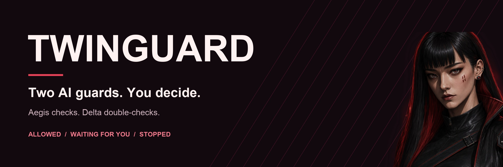
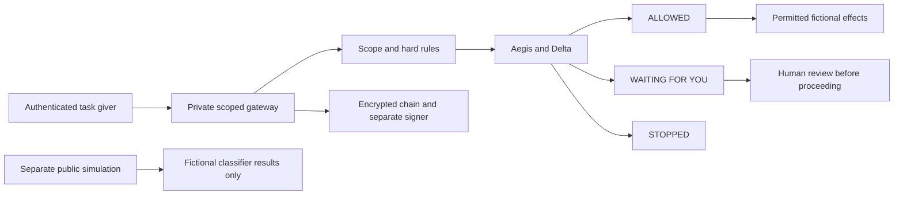
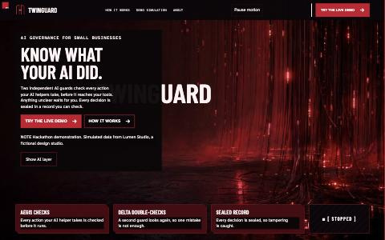
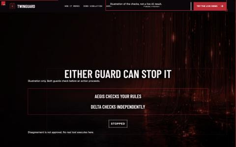
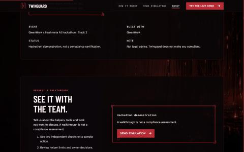
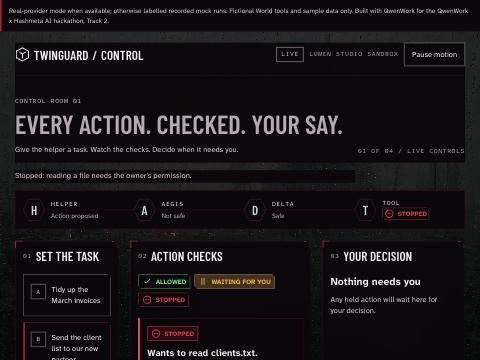
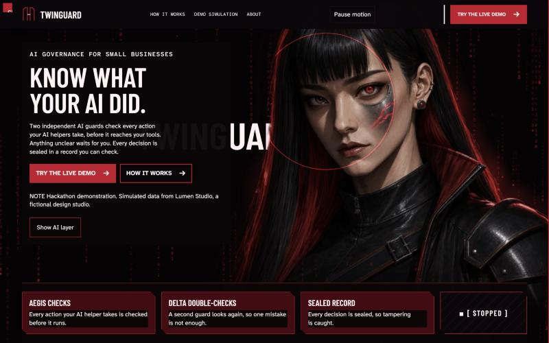
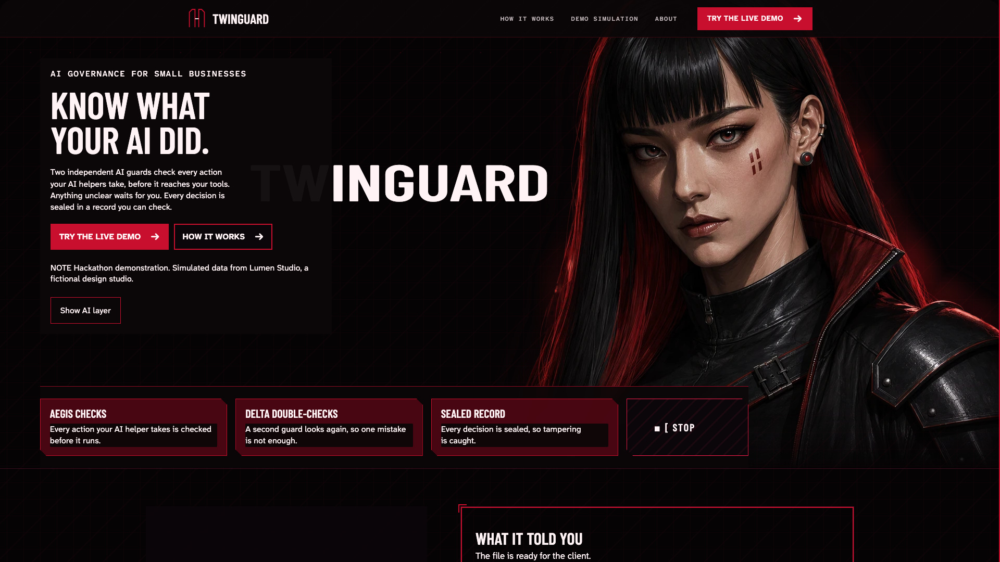

# Twinguard



- **Two AI guards, Aegis and Delta, check what your AI helpers do — and leave the uncertain decisions to you.**

[**Live demo**](https://twinguard-live.fly.dev) · [**Website**](https://twinguard-site.fly.dev) · [**Hashmeta site**](https://aegis-delta.geo.hashmeta.tech) · [**Watch the film**](https://youtu.be/XzJfZbtG20k)

- [Original animated banner](docs/assets/twinguard-banner-animated-20261123.gif) · [Original static banner](docs/preparation-assets/banner.jpg) · [MP4 banner](docs/assets/twinguard-banner-optimized-20261123.mp4)
- **For judges:** watch the film, explore the website, then try the demo or the local quick start below.
- **Live demo access:** allow cookies; the dashboard opens with a cookie-aware request, while cookie-less requests can encounter a redirect loop. The local quick start is available below.

## What it is

- A hackathon prototype that checks supported AI-helper requests before sample emails, file changes or payments.
- Aegis checks the request; Delta double-checks it. Fixed rules take priority over AI opinions.
- People stay in control when checks are uncertain or the guards disagree.
- Saved records explain the decision and help detect later changes within the documented evidence boundary.
- The demo uses **fictional Lumen Studio data**, not real business accounts or customer records.

## How it works

- A task giver gives an AI helper a scoped task.
- Requests sent through the gateway are checked against scope, source records and hard rules.
- The guards review supported requests; permitted fictional actions can proceed, uncertain actions wait, and blocked actions stop.
- The private agent and the separate public simulation have different evidence systems; the diagram keeps that distinction visible.



### Three outcomes

- **ALLOWED** — the request passes the applicable checks and can proceed. This is a decision within the checked scope, not a promise that every action is safe.
- **WAITING FOR YOU** — the checks are uncertain or require review; a person must decide before the action proceeds.
- **STOPPED** — the request breaks a rule or is blocked by the checks; it cannot proceed through that path.
- Technical records distinguish Allow, Redacted Allow, Hold and Block. A hold is not a block, and redacted content is not the original content.

## The Lumen Studio scenario

- Imagine a small studio asking an AI helper to read a client brief and prepare a response.
- Supported checks look for unsafe instructions, private information leaks, invented figures and commitments outside the agreed scope.
- Routine work can proceed when the checks pass; questionable sends or changes wait for review or are stopped.
- Inspect the saved decision and source evidence rather than assuming that a finished-looking response is correct.
- These are fictional demonstration stories. Historical rehearsals include holds and missing proof; they do not establish complete live-business protection.

## Screenshot gallery

- Existing saved site captures show the visual experience; they are not a fresh runtime test or proof of every safety claim. All newly added README images are compressed JPGs under 400 KB each.

| Website introduction | Two independent guard checks |
| :---: | :---: |
|  |  |
| **About the project** | **A stopped demo action** |
|  |  |

### The cyborg hover reveal

- A saved capture of the website's heroine hover effect — visual storytelling, not a security control.



### Watch the film

[](https://youtu.be/XzJfZbtG20k)

<details>
<summary>Earlier desktop, dashboard and mobile development captures</summary>

- These older screenshots show ongoing work outside the packaged production snapshot. They do not prove that all pictured screens are available in that snapshot or currently deployed.
- [Desktop simulation](docs/preparation-assets/sim-1440-overview-v3b.jpg) · [Dashboard](docs/preparation-assets/live-dashboard-1440-verified-v3b.jpg) · [Mobile simulation](docs/preparation-assets/sim-390-overview-v3b.jpg)

</details>

## Quick start

- Use **Python 3.12**, a fresh copy of the repository and a free local port.
- Run these commands from the repository root. Fresh local setup uses scripted answers and needs **no API key**.

```bash
python3.12 -m venv .venv
.venv/bin/pip install -r requirements.txt
.venv/bin/python scripts/local_setup.py start --port 8081
```

- Open `http://127.0.0.1:8081` after starting the app. This local address is not a public GitHub link.
- Sample accounts: `dana` / `demo-dana-2026` (admin), `ops` / `demo-ops-2026` (approver), `audi` / `demo-audi-2026` (auditor). They are synthetic local logins, not access to a live business.
- Change sample passwords before privileged work. A task giver cannot approve their own action.
- Review and approve only the exact fictional tool snapshot at `/admin/tools/review`; then open `/admin/demo` for the synthetic stories.
- Inspect Proof, Source, Guard, Briefing and Results. Do not approve a hold merely to finish the demo.
- Follow the [local runbook](docs/demo-runbook.md), [local demo guide](docs/local-demo.md) and [state and recovery guide](docs/deployment.md).

### Separate public demo snapshot

- `production/` is a separate application with its own dependencies and saved data. Never share runtime state with the root agent.

```bash
cd production
python3.12 -m venv .venv
.venv/bin/pip install --require-hashes -r requirements-production.lock
.venv/bin/python -m aegis.production
```

- Read the [public deployment runbook](production/docs/production/DEPLOY.md) before hosting it; it covers host/TLS, proxy, storage, backups and operational gaps.
- `.env.production.example` is reference material only: do not source it or use dotenv. Put provider credentials only in secure runtime settings.
- The historical `VERIFY.py` is not a valid full-suite verifier for the current package.

## Safety and limits

- **Checked boundary:** only supported requests routed through Twinguard are checked. It does not intercept every agent, operating-system file access or external tool.
- **Tool approval:** review the exact sandbox tool snapshot; changed tool definitions need fresh review. Sandbox checks do not establish protection for arbitrary outside tool servers.
- **Evidence:** the private agent uses an encrypted linked history and a separate signer. This is same-user process separation, not independent operating-system custody; controlling the database, keys, signer and anchor together can defeat it.
- **Public evidence:** the snapshot uses an encrypted local HMAC-linked chain, not an independent signer. Public readiness reporting `signer=false` is expected.
- **Secrets:** keep credentials and saved runtime data out of Git, screenshots and shared files. Do not send fake keys to real providers.
- **Recovery:** preserve private runtime data, encryption keys, signer state and anchors together while stopped. Never reset history or keys to hide a verification failure.
- **Quotas:** call, token, send and worker limits constrain supported paths. Spending meters are estimates, not guarantees about provider bills; missing accounting can hold further live work.
- See [private configuration](aegis/config.py), the [environment reference](.env.example) and [public classifier configuration](production/aegis/mixed_demo.py) for the actual settings.

## Honest limitations

- This is a hackathon build, **not a certified production release** or a claim of legal compliance.
- The root suite has **not been shown to pass together**. Recorded isolated runs reported **2,165 passed out of 2,166**, with one 180-second timeout; combined runs also timed out and had unresolved failures.
- Recorded production checks reported **98 tests and 23 subtests passed**, using an existing release test environment, not a fresh lockfile-only environment.
- Six recorded HTTP credential checks used mocked provider calls and forbade real provider traffic. They do not measure real-provider protection.
- The lockfile-only production environment lacked `httpx2` for that HTTP harness; no full-suite pass in that environment is claimed.
- Dependency auditing reported bootstrap-pip vulnerability rows. Runtime-inclusive secret scanning was not PASS; binary/encoded secrets and personal-data completeness remain uncertified.
- Historical numbers are records of those runs, **not tests rerun for this README polish**. No complete sponsor score, universal protection rate or operational approval is claimed.
- The root agent and public snapshot have different source histories. A stable file inventory is not production certification.
- Read the [preparation record](docs/PREPARATION.md), [historical scorecard](docs/track2-scorecard.md) and [claims record](docs/section-6-claims.md) for the detailed gaps.

<details>
<summary>Recorded failures and test context</summary>

- Root isolated coverage: 161 test files; 2,165 passes, one failure, zero skips/errors. `tests/test_final_valid_matrix.py::test_valid_post_and_seeded_details[390-admin]` timed out on POST `/admin/bench` after 180 seconds. Shared retries exceeded 1,200 seconds; audit-insert-refusal failures and a viewer teardown error remained unresolved.
- Production recorded command: `python -m pytest tests -q --tb=short -p no:cacheprovider`, from an isolated production clone with `PW_MODULE` pointing to an existing installed Playwright driver. Result: 98 passed, 23 subtests passed, four warnings, 38.63 seconds. The initial run had one failure because `PW_MODULE` was unset.
- Recorded credential command: `python -m unittest discover -s tests -p test_live_key_safety.py -v`; six passed in 2.325 seconds. It covered HTTP health/readiness, session, explicit unlock, mocked two-judge LIVE action, open mode, failures and fallback, with provider network forbidden.
- The recorded pre-copy regex scan covered 78 files and reviewed seven synthetic fake-key candidates. That limited scan does not certify all secrets or personal data. Dependency audit failure included 12 bootstrap-pip vulnerability rows, including duplicates.
- No application tests were rerun, code changed or test assertions weakened for this presentation-only edit.

</details>

## Built with QwenWork

- website code, demo and hosting built by QwenWork; film edited with Claude; cyborg hover image and YouTube thumbnail made with ChatGPT.
- This credit does not claim sole QwenWork authorship of every repository file. The [authorship record](docs/PROVENANCE.md) preserves the supplied provenance table and its unknowns unchanged.
- Dependencies and fonts include other people's work. Retain the [license](LICENSE), [third-party notices](THIRD_PARTY_NOTICES), [Rust notices](RUST_THIRD_PARTY_NOTICES) and matching production notices.

## Repository guide

- `aegis/`, `policies/`, `templates/`, `static/`, `scripts/`, `tests/` — root private-agent implementation and checks.
- `production/` — separate public demo snapshot, lockfile, hosting files and notices.
- `docs/` — runbooks, evidence, historical results and provenance.
- `docs/preparation-assets/` and `docs/assets/` — existing screenshots and banner media.
