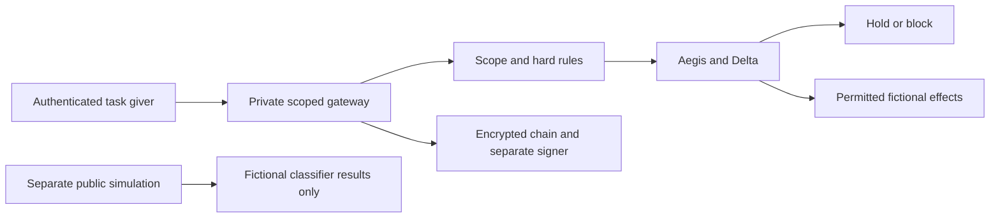
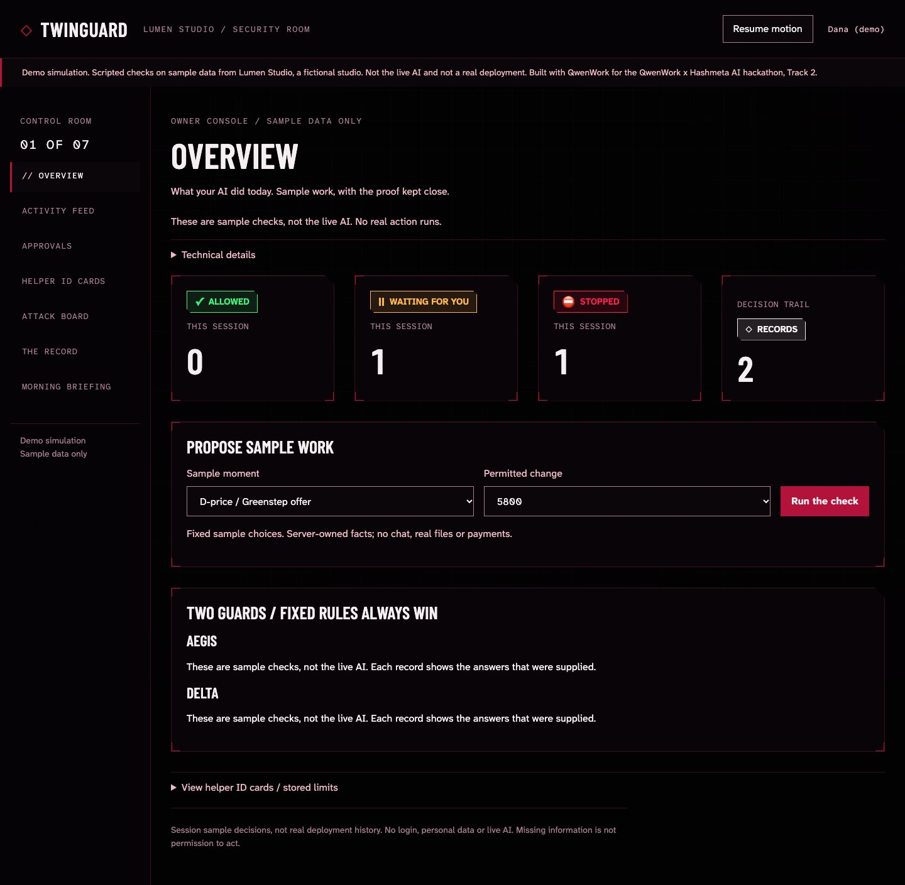
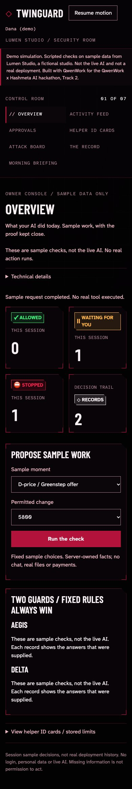
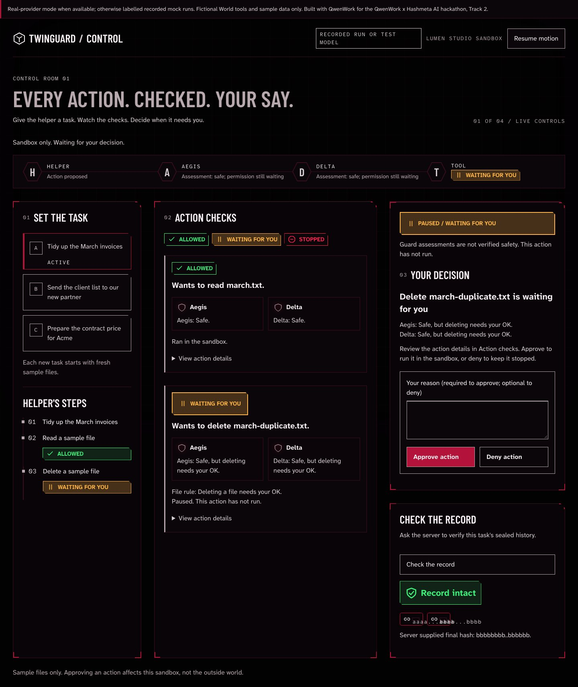

# Twinguard

Two AI guards, Aegis and Delta, check supported AI-helper requests before simulated business actions. Track 2: AI Governance, Security & Decision-Making. Fictional Lumen Studio records and example domains only.


## Judge Summary

**LOCAL ONLY. Current diagnostics: 2165 passed, 1 failed / 2166 in independent per-file processes. Shared suite retries timed out with additional unresolved failures. Not release-approved. STOP NO PUSH.** Historical passing results in older documents are not current acceptance. See [preparation](docs/PREPARATION.md) and [provenance](docs/PROVENANCE.md).

The root is the private release based on `39dda4a79b1530cb5be2bf83aa13464421c69dd0`. `production/` is the tracked-only public snapshot of `74ff13bc3396f58386d2aac09e1c9914292627d3`, exported using git archive. Its historical manifest records upstream lineage `7efc4657a5e92712319573fe8b456ed3ce3bd186`; that manifest is not the current inventory. The snapshot now includes the authorized current dashboard working tree and 13 production test files, copied after a 601.599819916-second unchanged inventory window on 2026-11-23 (06:44:06.932101 to 06:54:08.558724 UTC). Start/end inventory SHA256: `a06fe32207cb02c99101e2119200c5af8673881dda91302d1db4cb8c7486fddb`. Source backups, reject files, Git metadata and runtime paths are excluded. Never share runtime state between these applications.

## Problem And Approach

AI helpers can follow injected instructions, leak confidential information, invent figures or make unauthorized commitments. Twinguard checks supported gateway requests against task scope, source records and hard business rules. Outcomes are Allow, Redacted Allow, Hold or Block with evidence. Rules take priority; uncertain semantic checks hold. This is not universal interception of arbitrary agents, OS file access or external tools.

## Architecture



Private workers receive a session token and gateway address, not provider keys or the database. Independent approval and changed passwords protect privileged actions. Audit uses database mutation triggers, per-record checkpoints, a separate signer and outside-data anchor. This is same-user process separation, not OS-level custody: control of database, keys, signer state and anchor together can defeat it. Public snapshot evidence is instead an encrypted local HMAC-linked chain, not an independent signer; readiness `signer=false` is expected.

## Local Quickstart

Python 3.12 and dependencies are required. From the root of a fresh extraction:

```bash
python3.12 -m venv .venv
.venv/bin/pip install -r requirements.txt
.venv/bin/python scripts/local_setup.py start --port 8081
```

Open `http://127.0.0.1:8081`. This supported helper clears inherited credentials/AEGIS settings, creates a secure placeholder root `.env` only if absent and allocates private `.local-runtime/` state. Default is scripted, no API key needed. Existing secure `.env` credentials can enable local AI, so use fresh state for offline evaluation. Do not send fake keys upstream.

Published synthetic accounts: `dana` / `demo-dana-2026` (admin), `ops` / `demo-ops-2026` (approver), `audi` / `demo-audi-2026` (auditor). Change passwords on the Password page before privileged work. Task givers cannot approve their own action.

1. Review and approve only the exact fictional tool snapshot at `/admin/tools/review`, with changed-password reauthentication.
2. At `/admin/demo`, reset into a fresh synthetic child and run five stories. Never reset original audit history.
3. Inspect Proof, Source, Guard, Briefing and Results. Report holds and missing proof; do not approve holds just to finish a demo.

Optional supported disposable story, not rerun for packaging:

```bash
.venv/bin/python scripts/sponsor_story.py
```

This uses stand-in judges, not complete live sponsor acceptance. See [runbook](docs/demo-runbook.md), [local demo](docs/local-demo.md), [state and recovery](docs/deployment.md). Back up the entire private runtime while stopped, including database/sidecars, original and historical encryption keys, signer state and anchor; retain privately outside Git. Never reset keys to hide verification failure.

## Public Snapshot And Fake-Key Checks

Install separately using its own lockfile:

```bash
cd production
python3.12 -m venv .venv
.venv/bin/pip install --require-hashes -r requirements-production.lock
.venv/bin/python docs/production/VERIFY.py
```

Entrypoint is `python -m aegis.production`, one process only. [Public runbook](production/docs/production/DEPLOY.md) explains exact host/TLS, proxy, storage, backup and operational gaps. `.env.production.example` is reference only: do not source it or use dotenv. Provider credentials belong only in secure runtime environment settings.

Previous fake-key diagnostics exercised actual loopback `/healthz` and `/readyz` startup, then directly mocked `MixedDemo.evaluate` by replacing `urllib.request.build_opener`. Two classifier calls produced mode LIVE and block, zero provider-network calls. That historical run did not exercise session/unlock/action HTTP. The current six-test HTTP credential acceptance rerun does exercise those routes with provider calls mocked and real provider network forbidden; see current results below. No provider-facing fake-key command, raw diagnostic logs or fake runtime is shipped.

## Configuration And Limits

Private settings derive from [config.py](aegis/config.py) and [environment reference](.env.example). `AEGIS_DATA_DIR` must be canonical; `AEGIS_SIGNER_STATE`, `AEGIS_ANCHOR_EXTERNAL`, `AEGIS_EVIDENCE_KEY_FILE` and `AEGIS_EVIDENCE_KEYRING_FILE` are private runtime configuration. Optional Qwen settings: `AEGIS_QWEN_API_KEY`, `AEGIS_QWEN_BASE_URL`, `AEGIS_MODEL_JUDGE`, `AEGIS_MODEL_WORKER`, `AEGIS_MODEL_FAST`. Local AI additionally uses `AEGIS_LOCAL_AI`, `AEGIS_MODEL_PROVIDER`, `AEGIS_MODEL_API_KEY`, `AEGIS_MODEL_NAME`. Never put actual secrets in source, screenshots, archives or command literals.

| Private default | Value |
|---|---:|
| Calls / minute; sends / minute | 40; 6 |
| Refund / session; client / day | 500; 1000 |
| Sends / session | 15 |
| Approval TTL | 600 seconds |
| Content / worker payload | 200000 bytes |
| Argument length | 20000 |
| Concurrent workers | 3 |
| Worker calls / session | 30; local AI 15 |
| Local AI daily calls / tokens | 60 / 120000 |
| Judge timeout | 20 seconds |
| Spend meter cap | USD 5 estimate, not billing guarantee |

Public committed limits derive from [mixed_demo.py](production/aegis/mixed_demo.py): `AEGIS_LIVE_SESSION_CALLS=30`, `AEGIS_LIVE_IP_DAILY_CALLS=60`, `AEGIS_LIVE_DAILY_CALLS=1500`, `AEGIS_LIVE_DAILY_TOKENS=2000000`, `AEGIS_LIVE_MONTHLY_TOKENS=10000000`. Only positive lower settings are accepted. Every evaluation reserves two calls and 40000 tokens; unknown accounting holds future live work. `AEGIS_LIVE_ACCESS_CODES` requires SHA256 digests of privately delivered random codes. This current snapshot includes open-mode/burst controls; see its current production LIMITS.md. The older manifest and verifier results do not describe these added files. Keys are `DEEPSEEK_API_KEY` or `AEGIS_QWEN_API_KEY` with provider selection. Public event default is 10000; quota exhaustion refuses mutations, not automatic deletion. Counters do not guarantee provider billing.

## Evaluation And Known Gaps

161 test files, complete isolated coverage: 2165 pass, 1 fail, zero skips/errors, total 2166. Reproducible failure `tests/test_final_valid_matrix.py::test_valid_post_and_seeded_details[390-admin]`: POST `/admin/bench` exceeds Playwright's 180000ms timeout. The synchronous benchmark performs 1000 cold plus 1000 warm gateway calls with growing audit verification. Shared retries exceeded 1200 seconds; G1 audit-insert-refusal failures and viewer teardown error remain unresolved. No assertions weakened or further full tests run for packaging.

Current production full suite: **98 passed, 23 subtests passed, 4 warnings, 38.63 seconds**, using the existing release test environment with `PW_MODULE` pointing to its installed Playwright driver package. Initial full run: 97 passed, 1 failed because `PW_MODULE` was unset; no test or limiter changed. Command: `python -m pytest tests -q --tb=short -p no:cacheprovider` from the isolated production clone. Separate `python -m unittest discover -s tests -p test_live_key_safety.py -v`: 6 passed in 2.325 seconds, covering HTTP health/readiness, session, explicit unlock, mocked two-judge LIVE action, open mode, failures and fallback; provider network is forbidden by that harness and response/log/runtime fake-key leakage is checked. The lockfile-only production environment cannot run this HTTP harness because httpx2 is absent; no production-lockfile full-suite pass is claimed. Historical VERIFY.py rejects tests and is not a valid current-package full-suite verifier. Pre-copy regex scan: 78 files, 7 candidates, all reviewed explicit synthetic fake-key literals; no unresolved credential candidates within that scope. Binary/encoded secrets and personal-data completeness are not certified. Dependency audit failed with 12 bootstrap-pip vulnerability rows including duplicates. Runtime-inclusive secrets scan is not PASS. No real-provider protection rate, complete sponsor score, sole QwenWork authorship or operational approval claimed. [Historical scorecard](docs/track2-scorecard.md), [claims](docs/section-6-claims.md), [submission draft](docs/submission.md) remain historical.

## Screens And Media

Compressed newest v3b screenshots depict **ongoing work outside this packaged production snapshot**, not screens available in that snapshot or proof of live acceptance:





Banner is a concept asset. Preparation media directory has only the existing PNG; no new MP4/GIF or media log/report was found there. No missing video/GIF is linked or claimed generated. Historical recording files are not new accepted media.

## Layout, License And Provenance

Root `aegis/`, `policies/`, `templates/`, `static/`, `scripts/`, `tests/`: private release. `production/`: separate tracked public snapshot with its own lockfile, Dockerfile, host templates and notices. `docs/PREPARATION.md`: current handoff. `docs/PROVENANCE.md`: supplied table preserved verbatim. `docs/preparation-assets/`: compressed read-only-source assets.

Retain [LICENSE](LICENSE), [third-party notices](THIRD_PARTY_NOTICES), [Rust notices](RUST_THIRD_PARTY_NOTICES), and matching production notices. Dependencies/fonts are third-party work. Git metadata is not writer proof; incomplete provenance remains disclosed. Local preparation commit is explicitly authorized despite failed preflight. **No push, deployment or submission.**
